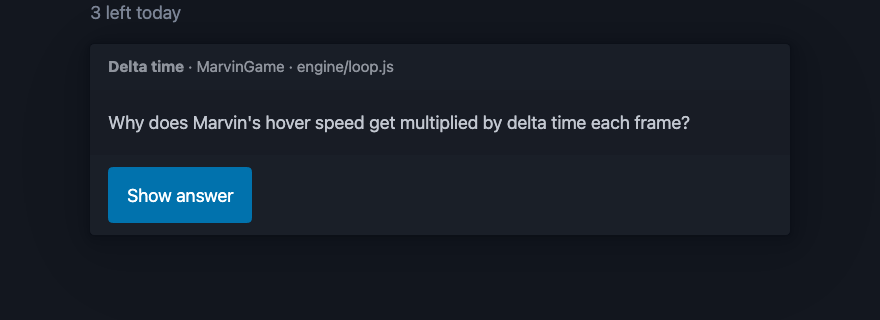

# Learn While Build

[](LICENSE)
[](.claude-plugin/plugin.json)
[](https://code.claude.com/docs/en/plugins)

A Claude Code plugin for people who vibe code and want to understand what
they built. Claude teaches as it builds, saves the concepts you met at the end
of a session, then quizzes you on them on a spaced-repetition schedule.



## How it works

1. **Set up a repo once** with `/learn-mode`. Claude reads the repo and adds
   teaching rules made for that project (its stack, its concepts, its files) to
   the repo's `CLAUDE.md`.
2. **Build as usual.** Claude names the concepts each step uses and leaves a
   small piece for you to write.
3. **Log at the end of a session** with `/learn-log`. Claude drafts the
   concepts you met, each with a question and answer; you approve them.
4. **Review when they're due.** New sessions in that repo show
   `📚 N concepts due`. Run `/learn-review` for a Claude-graded session, or
   drill the flashcards page.

| Command | What it does |
|---|---|
| `/learn-mode` | One-time setup per repo. Shows a draft before writing anything. |
| `/learn-log` | Saves this session's concepts after you approve them. Manual only. |
| `/learn-review` | Explains each due concept with your own code, quizzes you, grades you. |

## Requirements

- [Claude Code](https://code.claude.com)
- `python3` (standard library only, no packages)
- A browser with internet access for the flashcards page (it loads Alpine.js
  and Pico.css from a CDN)

## Install

```bash
claude plugin marketplace add Pranavraut033/learn-while-build
```

```bash
claude plugin install learn-while-build@learn-while-build
```

Start a new session afterwards so the commands load.

Update:

```bash
claude plugin update learn-while-build@learn-while-build
```

Uninstall (your notes file is kept):

```bash
claude plugin uninstall learn-while-build@learn-while-build
```

## Usage

A review session looks like this:

```text
> /learn-review
2 concepts due. First: Delta time.

In engine/loop.js, Marvin's bob is `y += speed * dt`. dt is the seconds since
the last frame, so a fast screen takes smaller steps more often…

Why would Marvin bob faster on a 144 Hz screen without dt?

> because it runs the loop more times per second

Clear: you named the cause. Next review in 2 days.
```

Each concept is stored like this:

```json
{
  "id": "delta-time",
  "name": "Delta time",
  "repos": ["MarvinGame"],
  "where": "engine/loop.js",
  "question": "Why does Marvin's hover speed get multiplied by delta time each frame?",
  "answer": "So the motion is the same speed on a 60 Hz and a 144 Hz screen.",
  "stage": 1,
  "due": "2026-10-27",
  "history": [{ "date": "2026-10-25", "result": "clear", "by": "claude" }]
}
```

## Schedule

Reviews come back after **1, 2, 7, 14, 30, 60** days.

| Grade | Flashcard button | Effect |
|---|---|---|
| clear | Good | Up one stage |
| retouch | Hard | Down one stage |
| unclear | Again | Back to 1 day |

In `/learn-review`, Claude decides the grade. On the flashcards page, you do.

## Flashcards page

```bash
python3 ~/.claude/plugins/marketplaces/learn-while-build/scripts/review.py serve
```

Open http://127.0.0.1:8777. Pass a port to use another one
(`review.py serve 9000`). The server only listens on 127.0.0.1.

## Configuration

| Setting | Default | What it does |
|---|---|---|
| `LEARN_STORE` env var | `~/.claude/learning/concepts.json` | Where your concepts are stored |
| `serve [PORT]` | `8777` | Port for the flashcards page |
| `<!-- learn-mode -->` in a repo's `CLAUDE.md` | written by `/learn-mode` | Turns on the session-start reminder for that repo |

All concepts live in one file, tagged with the repos they appeared in, so an
idea you meet in two projects has one schedule.

## Repo layout

```text
.claude-plugin/     plugin and marketplace manifests
hooks/hooks.json    session-start reminder
scripts/review.py   store, scheduler and flashcards server
web/cards.html      flashcards page
skills/             learn-mode, learn-log, learn-review
```

`scripts/review.py` subcommands:

| Command | What it does |
|---|---|
| `due` | Print due concepts as JSON |
| `list` | Print all concepts as JSON |
| `add` | Add a JSON list of concepts from stdin; known ids keep their schedule |
| `grade ID RESULT` | Grade a concept: `clear`, `retouch` or `unclear` |
| `serve [PORT]` | Run the flashcards page |
| `hook` | Session-start reminder, used by the plugin hook |
| `test` | Self-check of the scheduler |

## Contributing

Issues and pull requests are welcome. Run `python3 scripts/review.py test`
before opening a PR.

## License

[MIT](LICENSE)
